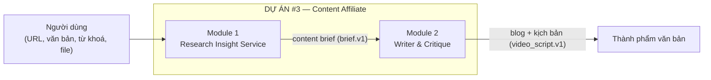
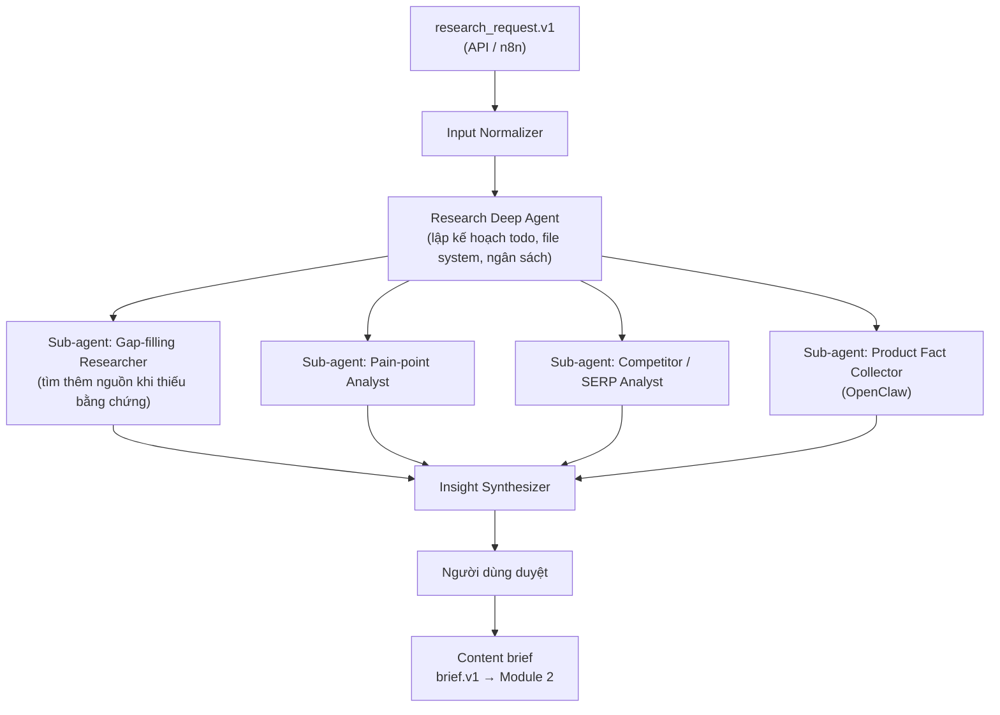
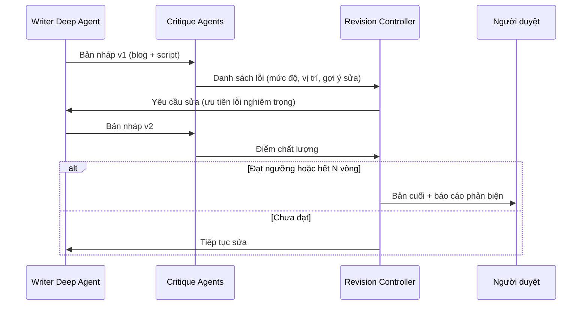

# Dự án #3 — Content Affiliate chuyên sâu

> **Nền tảng agent:** LangChain Deep Agents (trên LangGraph) · OpenClaw · n8n
> **Số nhóm:** 2 nhóm (mỗi nhóm 2 sinh viên) — mỗi nhóm nhận 1 module
> **Cấu trúc:** Module 1 (Research Insight Service) là **dịch vụ có API riêng**, cung cấp content brief cho Module 2 (Writer & Critique).
> **Loại đề tài:** Luận văn tốt nghiệp — Hệ thống đa tác nhân có lập kế hoạch dài hạn và tự phản biện

---

## 1. Bối cảnh & vấn đề

Nội dung affiliate chất lượng thấp (viết chung chung, không trải nghiệm thực tế, sai thông tin) ngày càng bị công cụ tìm kiếm và người đọc đánh giá thấp. Nội dung hiệu quả cần:

- Bám sát **pain points thật** của người dùng (lấy từ review, hỏi đáp, bài viết, thảo luận).
- Đạt chuẩn **E-E-A-T** (Experience, Expertise, Authoritativeness, Trustworthiness).
- **Không sai logic, không sai sự thật**, minh bạch về liên kết affiliate.

Dự án xây dựng hệ thống đa tác nhân **Research → Outline → Write → Critique**, sử dụng **Deep Agents** cho các tác vụ cần lập kế hoạch nhiều bước, **OpenClaw** cho các agent đọc trang / thu thập thông tin sản phẩm, và **n8n** để điều phối quy trình và kết nối dịch vụ.

**Phạm vi đầu ra là văn bản** (bài blog, kịch bản video có cấu trúc). Hệ thống **không** sản xuất audio/video; kịch bản được xuất dạng JSON để người dùng đưa vào công cụ dựng video có sẵn (TikTok Symphony, CapCut/Pippit, Creatify…).

---

## 2. Luồng tổng quát: Research → Viết & phản biện



| Định dạng dữ liệu | Bên tạo | Bên dùng | Chốt vào |
|-------------------|---------|----------|----------|
| `research_request.v1` | Người dùng / n8n | Module 1 | Tuần 3 |
| `brief.v1` (content brief) | Module 1 | Module 2 | Tuần 3 |
| `video_script.v1` | Module 2 | Người dùng / công cụ dựng video bên ngoài | Tuần 3 |

> Hai nhóm cùng chốt các định dạng này trong **tuần 3**. Thay đổi không tương thích phải tăng version và thông báo trước.

---

## 3. Mục tiêu dự án

| # | Mục tiêu | Tiêu chí đo lường (gợi ý) |
|---|----------|---------------------------|
| G1 | Nhận **đầu vào linh hoạt**: URL, văn bản, từ khoá, file dữ liệu hoặc kết hợp | Cả 5 chế độ đầu vào (mục 4.2) chạy end-to-end |
| G2 | Phân tích pain points & insight, có bằng chứng cho từng ý | 100% pain point và fact trong brief truy vết được về nguồn |
| G3 | Research Insight là **dịch vụ có API riêng**, tách biệt với Module 2 | API ổn định, có version, có OpenAPI spec |
| G4 | Viết blog / kịch bản video chuẩn E-E-A-T | Đạt ≥ 80% tiêu chí checklist E-E-A-T do nhóm xây dựng |
| G5 | Tự phản biện: phát hiện lỗi logic, sai sự thật, claim không có căn cứ | Giảm ≥ 50% lỗi so với bản nháp đầu (trên bộ test) |
| G6 | Kiểm soát chi phí nghiên cứu | Mỗi yêu cầu có ngân sách (số nguồn, token); đo và báo cáo chi phí mỗi brief |
| G7 | Human-in-the-loop ở các điểm quyết định | Duyệt brief và duyệt bản cuối trước khi xuất |

---

## 4. MODULE 1 — Research Insight Service (AI Researcher)

> Nhóm nhận module này chịu trách nhiệm về độ ổn định API, tài liệu và hỗ trợ tích hợp cho nhóm Module 2.

### 4.1. Mục tiêu module

1. Nhận **đầu vào linh hoạt**, chuẩn hoá về `research_request.v1`.
2. **Tự lập kế hoạch nghiên cứu** và tự tìm thêm nguồn khi đầu vào chưa đủ.
3. Phân tích sâu **pain points, mong muốn, phản đối (objections)** và **search intent** của người dùng.
4. Thu thập & kiểm chứng **thông tin sản phẩm** (thông số, giá, chính sách) có nguồn.
5. Xuất **content brief** (`brief.v1`) cho Module 2.
6. Nghiên cứu **theo yêu cầu, có ngân sách** — không chạy hàng loạt.

### 4.2. Đầu vào linh hoạt

| Chế độ | Người dùng đưa vào | Hệ thống xử lý |
|--------|--------------------|----------------|
| A. URL | Link bài blog, link sản phẩm, link video/review | Trích nội dung chính, thông tin sản phẩm, bình luận/đánh giá (nếu được phép) |
| B. Văn bản | Dán đoạn bài viết, ghi chú, mô tả sản phẩm, bản nháp, trải nghiệm cá nhân | Rút ra chủ đề, sản phẩm, claim, câu hỏi còn bỏ ngỏ |
| C. Từ khoá | Chủ đề hoặc từ khoá (VD: "ghế công thái học dưới 300$") | Agent tự lập kế hoạch nghiên cứu từ đầu |
| D. File dữ liệu | CSV/JSON (danh sách sản phẩm, review, dữ liệu xuất từ công cụ khác — VD: Chrome extension) | Đọc theo schema nhập, gắn nguồn `user_file` |
| E. Kết hợp | Bất kỳ tổ hợp nào của A–D | Gộp, khử trùng lặp, gắn trọng số theo nguồn |

```json
{
  "schema_version": "research_request.v1",
  "request_id": "rq_2026_10_29_0007",
  "inputs": [
    { "type": "url", "url": "https://example.com/best-office-chairs", "role": "competitor_article" },
    { "type": "url", "url": "https://example.com/products/chair-x", "role": "product_page" },
    { "type": "text", "content": "Mình bị đau lưng khi ngồi lâu, đã thử 2 loại ghế...", "role": "user_experience" },
    { "type": "keyword", "value": "ergonomic chair under $300" }
  ],
  "goal": "affiliate buying guide",
  "budget": { "max_sources": 25, "max_llm_cost_usd": 0.5 },
  "allow_web_research": true,
  "lang": "vi"
}
```

> Ghi chú `role: "user_experience"` (trải nghiệm thật của người dùng) là nguồn chính cho chữ **"Experience"** trong E-E-A-T. Agent không được tự bịa trải nghiệm.

### 4.3. Kiến trúc agent



| Agent | Nhiệm vụ |
|-------|----------|
| Input Normalizer | Gộp 5 chế độ đầu vào về `research_request.v1` |
| Research Deep Agent | Lập kế hoạch nghiên cứu (todo), điều phối sub-agents, lưu ghi chú vào file system của agent, theo dõi ngân sách |
| Gap-filling Researcher | Đánh giá đầu vào đã đủ bằng chứng chưa; nếu chưa, tự tìm thêm (web, trang sản phẩm) trong giới hạn ngân sách |
| Pain-point Analyst | Gom cụm pain points/desires/objections, xếp hạng theo tần suất & mức độ, gắn evidence |
| Competitor / SERP Analyst | Phân tích nội dung đối thủ đang xếp hạng, tìm khoảng trống nội dung (content gap) |
| Product Fact Collector | Agent OpenClaw đọc trang sản phẩm: thông số, giá, chính sách; ghi nguồn và thời điểm |
| Insight Synthesizer | Tổng hợp kết quả các sub-agent thành content brief, ghi rõ phần còn thiếu (`gaps`) |

### 4.4. Kiểm soát chi phí

Đây là yêu cầu bắt buộc, không phải tối ưu thêm:

- **Theo yêu cầu, không hàng loạt:** chỉ nghiên cứu khi có `research_request`, giới hạn số nguồn mỗi yêu cầu.
- **Phân tầng mô hình:** mô hình rẻ cho trích xuất / phân loại / tóm tắt từng nguồn; mô hình mạnh chỉ cho bước tổng hợp cuối.
- **Cache:** nội dung URL và kết quả trích xuất được lưu lại; cùng một nguồn không phân tích hai lần.
- **Dừng sớm:** Gap-filling Researcher dừng khi đủ bằng chứng hoặc hết ngân sách, và ghi rõ trong brief phần nào còn thiếu.
- **Đo lường:** mỗi brief ghi lại số nguồn, số token, chi phí, thời gian.

### 4.5. Content brief (`brief.v1`) → Module 2

```json
{
  "schema_version": "brief.v1",
  "brief_id": "br_2026_10_29_0004",
  "research_id": "rs_2026_10_29_0007",
  "topic": "Best ergonomic office chairs under $300 for back pain",
  "audience": { "persona": "remote worker, 25-40", "intent": "commercial investigation" },
  "pain_points": [
    { "text": "lower back pain after 4+ hours", "evidence": ["user_text:1", "url:review-site"], "weight": 0.9 }
  ],
  "products": [
    { "name": "...", "affiliate_url": "...", "facts": { "price": "...", "warranty": "..." }, "fact_sources": ["..."] }
  ],
  "angle": "comparison + buying guide",
  "outline": [
    { "h2": "Why your chair causes back pain", "points": ["..."], "evidence": ["..."] },
    { "h2": "Top 5 picks compared", "points": ["..."] }
  ],
  "formats": ["blog", "video_script"],
  "eeat_requirements": ["first-hand experience notes", "author bio", "cite sources", "affiliate disclosure"],
  "gaps": ["chưa có dữ liệu bảo hành của sản phẩm #3"],
  "lang": "en"
}
```

### 4.6. API dịch vụ

| Endpoint | Mô tả |
|----------|-------|
| `POST /research` | Gửi `research_request.v1`, trả `research_id` (chạy bất đồng bộ) |
| `GET /research/{id}` | Trạng thái, tiến độ (todo list của agent), chi phí đã dùng |
| `GET /research/{id}/brief` | Lấy `brief.v1` |
| Webhook `research.completed` | Báo cho n8n / Module 2 |

### 4.7. Sản phẩm bàn giao

- [ ] Input Normalizer hỗ trợ đủ 5 chế độ đầu vào
- [ ] Research Deep Agent với ≥ 4 sub-agents
- [ ] Content brief `brief.v1` có evidence cho mọi pain point và fact
- [ ] API dịch vụ + webhook + OpenAPI spec
- [ ] **Bộ ≥ 20 brief mẫu giao cho Module 2 trước tuần 4**
- [ ] Cơ chế ngân sách, cache, phân tầng mô hình
- [ ] Dashboard duyệt brief
- [ ] Báo cáo đánh giá: độ chính xác pain point (so với gán nhãn tay), độ phủ content gap, tỉ lệ fact có nguồn, chi phí & thời gian mỗi brief, so sánh chất lượng giữa các chế độ đầu vào

### 4.8. Gợi ý phân công

| Thành viên | Phụ trách |
|------------|-----------|
| SV1 | Input Normalizer, Product Fact Collector (OpenClaw), API dịch vụ, n8n, cache & ngân sách, dashboard duyệt |
| SV2 | Research Deep Agent, Gap-filling Researcher, Pain-point Analyst, Competitor Analyst, Insight Synthesizer, đánh giá |

---

## 5. MODULE 2 — Writer & Critique (AI Writer, Critique)

### 5.1. Mục tiêu module

1. Từ content brief đã duyệt, viết **bài blog** chuẩn E-E-A-T.
2. Chuyển thể thành **kịch bản video có cấu trúc** (`video_script.v1`) để người dùng đưa vào công cụ dựng video có sẵn.
3. **Tự kiểm duyệt chéo** bằng nhiều agent phản biện, lặp sửa đến khi đạt ngưỡng chất lượng.
4. Xuất thành phẩm văn bản (Markdown/HTML, JSON), tuỳ chọn đăng bản nháp lên CMS qua n8n.

> **Không thuộc phạm vi:** TTS, audio, dựng video, thumbnail — người dùng dùng công cụ dựng video có sẵn trên thị trường.

### 5.2. Các agent

| Agent | Nhiệm vụ |
|-------|----------|
| Writer Deep Agent | Lập kế hoạch viết theo từng section, lưu bản nháp vào file system, viết theo giọng văn/persona |
| Script Adapter | Chuyển bài viết thành `video_script.v1`: hook, cảnh, lời thoại, chữ trên màn hình, gợi ý hình ảnh, CTA |
| Logic Critic | Phát hiện mâu thuẫn, lập luận yếu, kết luận không theo sau tiền đề |
| Fact Critic | Đối chiếu mọi claim với `facts`/`evidence` trong brief; claim không có nguồn → gắn cờ |
| E-E-A-T Critic | Chấm theo checklist: trải nghiệm thực tế, chuyên môn, nguồn dẫn, minh bạch |
| Compliance Critic | Kiểm tra affiliate disclosure, claim y tế/tài chính, chính sách nền tảng |
| Revision Controller | Tổng hợp phản biện → yêu cầu Writer sửa; dừng khi đạt ngưỡng hoặc hết số vòng tối đa |

### 5.3. Vòng lặp tự phản biện



> Báo cáo phản biện (lỗi phát hiện / đã sửa / còn tồn tại) phải được lưu lại — đây là dữ liệu chính để đánh giá trong luận văn. Để tiết kiệm, Critic chỉ chấm lại **các đoạn đã sửa** ở vòng sau, không chấm lại toàn bài.

### 5.4. Kịch bản video có cấu trúc (`video_script.v1`)

```json
{
  "schema_version": "video_script.v1",
  "script_id": "vs_2026_10_29_0004",
  "brief_id": "br_2026_10_29_0004",
  "aspect_ratio": "9:16",
  "target_duration_s": 30,
  "voice": { "tone": "friendly, calm", "lang": "vi" },
  "scenes": [
    {
      "id": 1,
      "duration_s": 3,
      "purpose": "hook",
      "voiceover": "Ngồi làm việc 4 tiếng là đau lưng?",
      "on_screen_text": "Đau lưng khi ngồi lâu?",
      "visual_hint": "người ôm lưng trước bàn làm việc, ánh sáng dịu",
      "claims": []
    },
    {
      "id": 2,
      "duration_s": 6,
      "purpose": "selling_point",
      "voiceover": "Chair X có đệm lưng dưới điều chỉnh được...",
      "on_screen_text": "Đệm lưng điều chỉnh",
      "visual_hint": "cận cảnh phần đệm lưng của sản phẩm",
      "claims": [{ "text": "adjustable lumbar support", "evidence": ["url:product_page"] }]
    }
  ],
  "cta": "Xem giá ở link bên dưới",
  "disclosure": "Bài viết có chứa liên kết affiliate"
}
```

### 5.5. Sản phẩm bàn giao

- [ ] Writer Deep Agent sinh blog từ `brief.v1`
- [ ] Script Adapter sinh `video_script.v1` hợp lệ (có validator schema)
- [ ] ≥ 4 Critique Agents + Revision Controller
- [ ] Checklist E-E-A-T có thể chấm tự động (rubric)
- [ ] Xuất Markdown/HTML + JSON; tuỳ chọn đăng nháp lên CMS qua n8n
- [ ] Báo cáo đánh giá: số lỗi trước/sau phản biện, điểm E-E-A-T, đánh giá người đọc (user study nhỏ), chi phí & thời gian mỗi thành phẩm

### 5.6. Gợi ý phân công

| Thành viên | Phụ trách |
|------------|-----------|
| SV1 | Writer Deep Agent, Script Adapter, Revision Controller |
| SV2 | Logic / Fact / E-E-A-T / Compliance Critic, rubric E-E-A-T, n8n xuất bản, đánh giá |

### 5.7. Phát triển song song với Module 1

Module 2 dùng bộ **brief mẫu** do Module 1 giao từ tuần 4; tích hợp API thật từ tuần 9.

---

## 6. Công nghệ đề xuất

| Lớp | Công nghệ |
|-----|-----------|
| Agent framework | LangChain `deepagents`, LangGraph (checkpoint, human-in-the-loop interrupt) |
| Agent đọc trang | OpenClaw + skills tuỳ biến |
| Orchestration | n8n (self-hosted) |
| LLM | Cấu hình được (Claude / Gemini / GPT / mô hình mở); phân tầng mô hình rẻ / mạnh |
| Quan sát & đánh giá | LangSmith hoặc Langfuse (theo dõi token, chi phí, vòng lặp) |
| Lưu trữ | PostgreSQL (+ pgvector), cache nội dung URL |
| API | FastAPI, OpenAPI |
| Dashboard | Next.js / Streamlit |

---

## 7. Lộ trình gợi ý (16 tuần)

| Tuần | Module 1 (Research Insight Service) | Module 2 (Writer & Critique) |
|------|-------------------------------------|------------------------------|
| 1–2 | Nghiên cứu Deep Agents, OpenClaw, E-E-A-T | Nghiên cứu Deep Agents, kỹ thuật self-critique |
| 3 | **Chốt `research_request.v1`, `brief.v1` với Module 2** | **Chốt `brief.v1`, `video_script.v1` với Module 1** |
| 4 | Giao brief mẫu | Writer Deep Agent trên brief mẫu |
| 4–7 | Input Normalizer + Research Deep Agent + sub-agents | Writer + Script Adapter |
| 8–10 | API dịch vụ, ngân sách, cache, dashboard duyệt | Critique Agents + Revision loop |
| 11–12 | Hoàn thiện, đánh giá chất lượng insight & chi phí | Rubric E-E-A-T, xuất bản qua n8n |
| 13–14 | Tích hợp end-to-end với Module 2 | Tích hợp end-to-end, user study |
| 15–16 | Luận văn + demo | Luận văn + demo |

## 8. Rủi ro & lưu ý

- **Module 2 phụ thuộc Module 1:** giao brief mẫu sớm; dùng versioning cho mọi định dạng dữ liệu.
- **Chi phí nghiên cứu:** bắt buộc có ngân sách mỗi yêu cầu, cache và phân tầng mô hình.
- **Hallucination về sản phẩm:** mọi số liệu sản phẩm phải có nguồn; Fact Critic chặn claim không có nguồn.
- **E-E-A-T "Experience":** AI không có trải nghiệm thực tế — hệ thống lấy trải nghiệm từ người dùng (`user_experience`), không bịa trải nghiệm.
- **Thu thập từ URL:** tôn trọng điều khoản trang web và `robots.txt`; chỉ lấy nội dung cần cho phân tích, không đăng lại nguyên văn nội dung của người khác.
- **Tuân thủ:** bắt buộc affiliate disclosure; tránh claim y tế/tài chính không có căn cứ.
