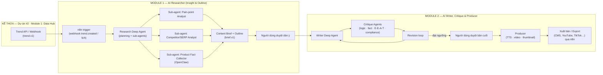
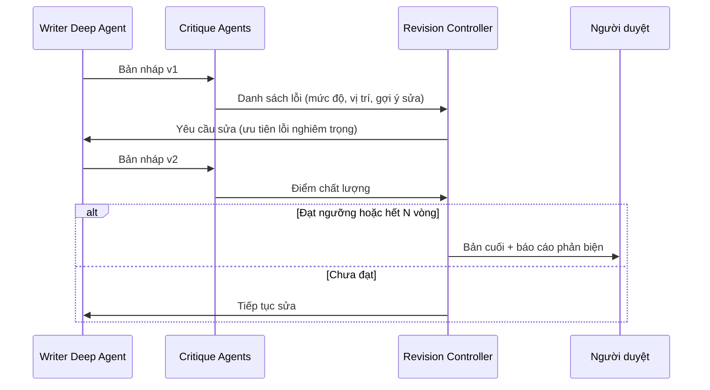

# Dự án #3 — Content Affiliate chuyên sâu

> **Nền tảng agent:** LangChain Deep Agents (trên LangGraph) · OpenClaw · n8n
> **Số nhóm:** 2 nhóm (mỗi nhóm 2 sinh viên) — mỗi nhóm nhận 1 module
> **Kế thừa:** Sử dụng lại **Module 1 của Dự án #2 — Centralized Spy Trend & Data Orchestration (Data Hub chung)** làm nguồn dữ liệu đầu vào.
> **Loại đề tài:** Luận văn tốt nghiệp — Hệ thống đa tác nhân có lập kế hoạch dài hạn, tự phản biện và sản xuất media

---

## 1. Bối cảnh & vấn đề

Nội dung affiliate chất lượng thấp (viết chung chung, không trải nghiệm thực tế, sai thông tin) ngày càng bị công cụ tìm kiếm và người đọc đánh giá thấp. Nội dung hiệu quả cần:

- Bám sát **pain points thật** của người dùng (lấy từ review, hỏi đáp, xu hướng).
- Đạt chuẩn **E-E-A-T** (Experience, Expertise, Authoritativeness, Trustworthiness).
- **Không sai logic, không sai sự thật**, minh bạch về liên kết affiliate.
- Có nhiều định dạng: blog, kịch bản video, audio, video ngắn.

Dự án xây dựng hệ thống đa tác nhân **Research → Outline → Write → Critique → Produce**, sử dụng **Deep Agents** cho các tác vụ cần lập kế hoạch nhiều bước, **OpenClaw** cho các agent thao tác/thu thập bổ sung, và **n8n** để điều phối quy trình và kết nối dịch vụ.

---

## 2. Mục tiêu dự án

| # | Mục tiêu | Tiêu chí đo lường (gợi ý) |
|---|----------|---------------------------|
| G1 | Tái sử dụng Data Hub của Dự án #2 làm nguồn dữ liệu thị trường | Tích hợp qua Trend API `trend.v1`, không sao chép logic thu thập |
| G2 | Phân tích pain points & insight, lập dàn ý nội dung affiliate | Mỗi dàn ý truy vết được về dữ liệu nguồn (evidence) |
| G3 | Viết blog / kịch bản video chuẩn E-E-A-T | Đạt ≥ 80% tiêu chí checklist E-E-A-T do nhóm xây dựng |
| G4 | Tự phản biện: phát hiện lỗi logic, sai sự thật, claim không có căn cứ | Giảm ≥ 50% lỗi so với bản nháp đầu (trên bộ test) |
| G5 | Xuất thành phẩm media (Audio/Video) | Sinh được audio (TTS) + video ngắn từ kịch bản |
| G6 | Có human-in-the-loop ở các điểm quyết định | Duyệt dàn ý và duyệt bản cuối trước khi xuất bản |

---

## 3. Kiến trúc tổng thể



### 3.1. Vai trò từng công nghệ

| Công nghệ | Vai trò |
|-----------|---------|
| **LangChain Deep Agents** | Agent "sâu": tự lập kế hoạch (todo list), dùng **sub-agents** chuyên biệt, **file system ảo** để lưu ghi chú/bản nháp dài, phù hợp tác vụ nghiên cứu và viết nhiều bước |
| **OpenClaw** | Agent thao tác: đọc trang sản phẩm, thu thập thông số/giá/đánh giá bổ sung, kiểm tra link affiliate; chạy theo lịch hoặc theo yêu cầu |
| **n8n** | Điều phối: nhận webhook từ Data Hub, gọi Deep Agents qua API, quản lý hàng đợi, gửi thông báo duyệt, gọi dịch vụ TTS/video, xuất bản |

### 3.2. Kế thừa Data Hub (Dự án #2 · Module 1)

- Dự án #3 **không tự xây lại** pipeline thu thập; mọi dữ liệu thị trường lấy từ **Trend API** của Data Hub.
- Trường quan trọng nhất: `signals.review_insights` (pain points, desires), `related_keywords`, `top_listings`, `metrics`.
- Nếu cần dữ liệu mà Data Hub chưa có (VD: Q&A, forum), nhóm Dự án #3 **đề xuất yêu cầu** (issue/feature request) cho nhóm Data Hub, hoặc viết **connector bổ sung theo chuẩn plug-in của Data Hub** — không xây pipeline riêng.
- Ba nhóm (Dự án #2 Module 1, Module 2 và Dự án #3 Module 1) cùng chốt data contract trong **tuần 3**.

### 3.3. Data Contract giữa Module 1 và Module 2 (`brief.v1`)

```json
{
  "schema_version": "brief.v1",
  "brief_id": "br_2026_10_29_0004",
  "source_trend_ids": ["tr_2026_10_29_0012"],
  "topic": "Best ergonomic office chairs under $300 for back pain",
  "audience": { "persona": "remote worker, 25-40", "intent": "commercial investigation" },
  "pain_points": [
    { "text": "lower back pain after 4+ hours", "evidence": ["review:amz:...", "trend:..."], "weight": 0.9 }
  ],
  "products": [
    { "name": "...", "affiliate_url": "...", "facts": { "price": "...", "warranty": "..." }, "fact_sources": ["..."] }
  ],
  "angle": "comparison + buying guide",
  "outline": [
    { "h2": "Why your chair causes back pain", "points": ["..."], "evidence": ["..."] },
    { "h2": "Top 5 picks compared", "points": ["..."] }
  ],
  "formats": ["blog", "video_script"],
  "eeat_requirements": ["first-hand testing notes", "author bio", "cite sources", "affiliate disclosure"],
  "lang": "en"
}
```

---

## 4. MODULE 1 — Phân tích Insight & Lập dàn ý (AI Researcher)

### 4.1. Mục tiêu module

1. Lấy dữ liệu thị trường từ **Data Hub** (kế thừa Dự án #2).
2. Phân tích sâu **pain points, mong muốn, phản đối (objections)** của người dùng.
3. Xác định góc tiếp cận nội dung (so sánh, hướng dẫn mua, review, giải quyết vấn đề) và **search intent**.
4. Thu thập & kiểm chứng **thông tin sản phẩm** (thông số, giá, chính sách) có nguồn.
5. Sinh **Content Brief + Dàn ý** chuẩn `brief.v1`, mỗi ý đều truy vết được về bằng chứng.

### 4.2. Chức năng chi tiết

| Thành phần | Mô tả | Mức độ |
|------------|-------|--------|
| Trend consumer | Nhận `trend.created` qua webhook n8n hoặc truy vấn Trend API theo chủ đề | Bắt buộc |
| Research Deep Agent | Lập kế hoạch nghiên cứu (todo), điều phối sub-agents, lưu ghi chú vào file system của agent | Bắt buộc |
| Pain-point Analyst | Gom cụm pain points, xếp hạng theo tần suất & mức độ, gắn evidence | Bắt buộc |
| Competitor/SERP Analyst | Phân tích nội dung đối thủ đang xếp hạng: khoảng trống nội dung (content gap) | Bắt buộc |
| Product Fact Collector | Agent OpenClaw thu thập thông số/giá/đánh giá; ghi nguồn và thời điểm | Bắt buộc |
| Outline Generator | Sinh dàn ý H2/H3, ý chính, vị trí đặt sản phẩm, FAQ | Bắt buộc |
| Human-in-the-loop | Dashboard để người dùng duyệt/sửa brief trước khi chuyển Module 2 | Bắt buộc |
| Insight dashboard | Trực quan hoá pain points theo niche/thời gian | Khuyến khích |

### 4.3. Sản phẩm bàn giao

- [ ] Tích hợp Trend API của Data Hub (không trùng lặp logic thu thập)
- [ ] Research Deep Agent với ≥ 3 sub-agents
- [ ] Sinh brief `brief.v1` có evidence cho mọi pain point và fact
- [ ] Dashboard duyệt brief
- [ ] Bộ ≥ 30 brief mẫu cho Module 2 phát triển song song (từ tuần 4)
- [ ] Báo cáo đánh giá: độ chính xác pain point (so với gán nhãn tay), độ phủ content gap, tỉ lệ fact có nguồn

### 4.4. Gợi ý phân công

| Thành viên | Phụ trách |
|------------|-----------|
| SV1 | Tích hợp Data Hub, n8n workflows, Product Fact Collector (OpenClaw), dashboard duyệt |
| SV2 | Research Deep Agent, Pain-point Analyst, Competitor Analyst, Outline Generator, đánh giá |

---

## 5. MODULE 2 — Sáng tạo Content, Kiểm duyệt & Media (AI Writer, Critique & Producer)

### 5.1. Mục tiêu module

1. Từ brief đã duyệt, viết **bài blog** và **kịch bản video** chuẩn E-E-A-T.
2. **Tự kiểm duyệt chéo** bằng nhiều agent phản biện, lặp sửa đến khi đạt ngưỡng chất lượng.
3. Đóng gói thành phẩm media: **audio (TTS/podcast)**, **video ngắn/dài**, thumbnail.
4. Xuất bản hoặc xuất file qua n8n.

### 5.2. Các agent

| Agent | Nhiệm vụ |
|-------|----------|
| Writer Deep Agent | Lập kế hoạch viết theo từng section, lưu bản nháp vào file system, viết theo giọng văn/persona |
| Script Adapter | Chuyển bài viết thành kịch bản video (hook, cảnh, lời thoại, B-roll, CTA) |
| Logic Critic | Phát hiện mâu thuẫn, lập luận yếu, kết luận không theo sau tiền đề |
| Fact Critic | Đối chiếu mọi claim với `facts`/`evidence` trong brief; claim không có nguồn → gắn cờ |
| E-E-A-T Critic | Chấm theo checklist: trải nghiệm thực tế, chuyên môn, nguồn dẫn, minh bạch |
| Compliance Critic | Kiểm tra affiliate disclosure, claim y tế/tài chính, chính sách nền tảng |
| Revision Controller | Tổng hợp phản biện → yêu cầu Writer sửa; dừng khi đạt ngưỡng hoặc hết số vòng tối đa |
| Producer | TTS → audio; ghép video (giọng đọc + hình ảnh/B-roll + phụ đề); tạo thumbnail |

### 5.3. Vòng lặp tự phản biện



> Báo cáo phản biện (lỗi phát hiện / đã sửa / còn tồn tại) phải được lưu lại — đây là dữ liệu chính để đánh giá trong luận văn.

### 5.4. Sản phẩm bàn giao

- [ ] Writer Deep Agent sinh blog + kịch bản video từ `brief.v1`
- [ ] ≥ 4 Critique Agents + Revision Controller
- [ ] Checklist E-E-A-T có thể chấm tự động (rubric)
- [ ] Producer: audio (TTS) + video ngắn có phụ đề + thumbnail
- [ ] n8n workflow xuất bản/xuất file
- [ ] Báo cáo đánh giá: số lỗi trước/sau phản biện, điểm E-E-A-T, đánh giá người đọc (user study nhỏ), chi phí & thời gian mỗi thành phẩm

### 5.5. Gợi ý phân công

| Thành viên | Phụ trách |
|------------|-----------|
| SV1 | Writer Deep Agent, Script Adapter, Critique Agents, Revision Controller |
| SV2 | Producer (TTS, video, thumbnail), n8n xuất bản, rubric E-E-A-T & đánh giá |

### 5.6. Phát triển song song với Module 1

Module 2 dùng bộ **brief mẫu** do Module 1 cung cấp từ tuần 4; tích hợp pipeline thật từ tuần 9.

---

## 6. Công nghệ đề xuất

| Lớp | Công nghệ |
|-----|-----------|
| Agent framework | LangChain `deepagents`, LangGraph (checkpoint, human-in-the-loop interrupt) |
| Agent thao tác | OpenClaw + skills tuỳ biến |
| Orchestration | n8n (self-hosted) |
| LLM | Cấu hình được (Claude / Gemini / GPT / mô hình mở) |
| Quan sát & đánh giá | LangSmith hoặc Langfuse |
| TTS | Google Cloud TTS / ElevenLabs / mô hình mở (VD: XTTS) |
| Video | FFmpeg, MoviePy, Remotion |
| Lưu trữ | PostgreSQL (+ pgvector), MinIO/S3 |
| Dashboard | Next.js / Streamlit |

---

## 7. Lộ trình gợi ý (16 tuần)

| Tuần | Module 1 (AI Researcher) | Module 2 (Writer, Critique & Producer) |
|------|--------------------------|----------------------------------------|
| 1–2 | Nghiên cứu Deep Agents, OpenClaw, E-E-A-T; tìm hiểu Trend API của Data Hub | Nghiên cứu Deep Agents, kỹ thuật self-critique, TTS/video |
| 3 | **Chốt `trend.v1` với nhóm Data Hub; chốt `brief.v1` với Module 2** | Chốt `brief.v1` |
| 4–7 | Research Deep Agent + sub-agents (dùng seed data của Data Hub); bàn giao brief mẫu | Writer Deep Agent + Script Adapter trên brief mẫu |
| 8–10 | Tích hợp Data Hub thật, Product Fact Collector, dashboard duyệt | Critique Agents + Revision loop |
| 11–12 | Hoàn thiện, đánh giá chất lượng insight | Producer (audio/video), n8n xuất bản |
| 13–14 | Tích hợp end-to-end với Module 2 | Tích hợp end-to-end, user study |
| 15–16 | Luận văn + demo | Luận văn + demo |

## 8. Rủi ro & lưu ý

- **Phụ thuộc Data Hub:** Nếu Data Hub chậm tiến độ, dùng seed data `trend.v1`; không tự xây pipeline thu thập riêng.
- **Hallucination về sản phẩm:** Mọi số liệu sản phẩm phải có nguồn; Fact Critic chặn claim không có nguồn.
- **E-E-A-T "Experience":** AI không có trải nghiệm thực tế — hệ thống phải có chỗ cho người dùng bổ sung ghi chú trải nghiệm thật, và không được bịa trải nghiệm.
- **Tuân thủ:** Bắt buộc affiliate disclosure; tránh claim y tế/tài chính không có căn cứ; tôn trọng bản quyền hình ảnh/nhạc trong video.
- **Chi phí:** Vòng lặp phản biện tốn token — đặt giới hạn số vòng và đo chi phí mỗi thành phẩm.
